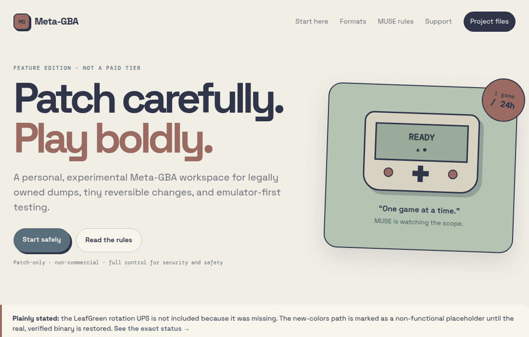
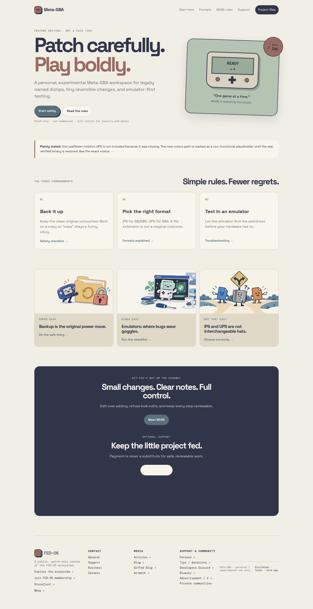
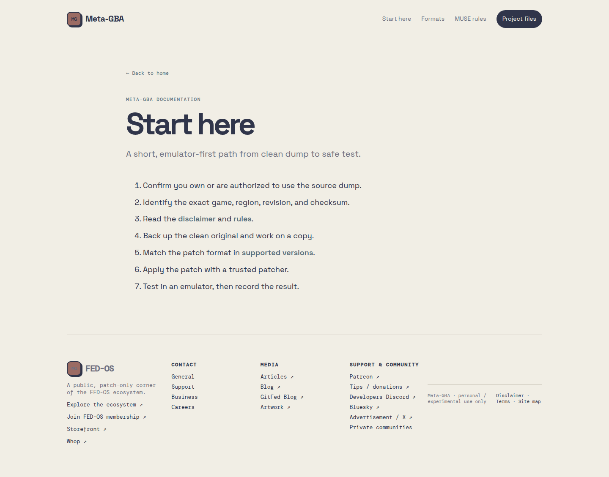
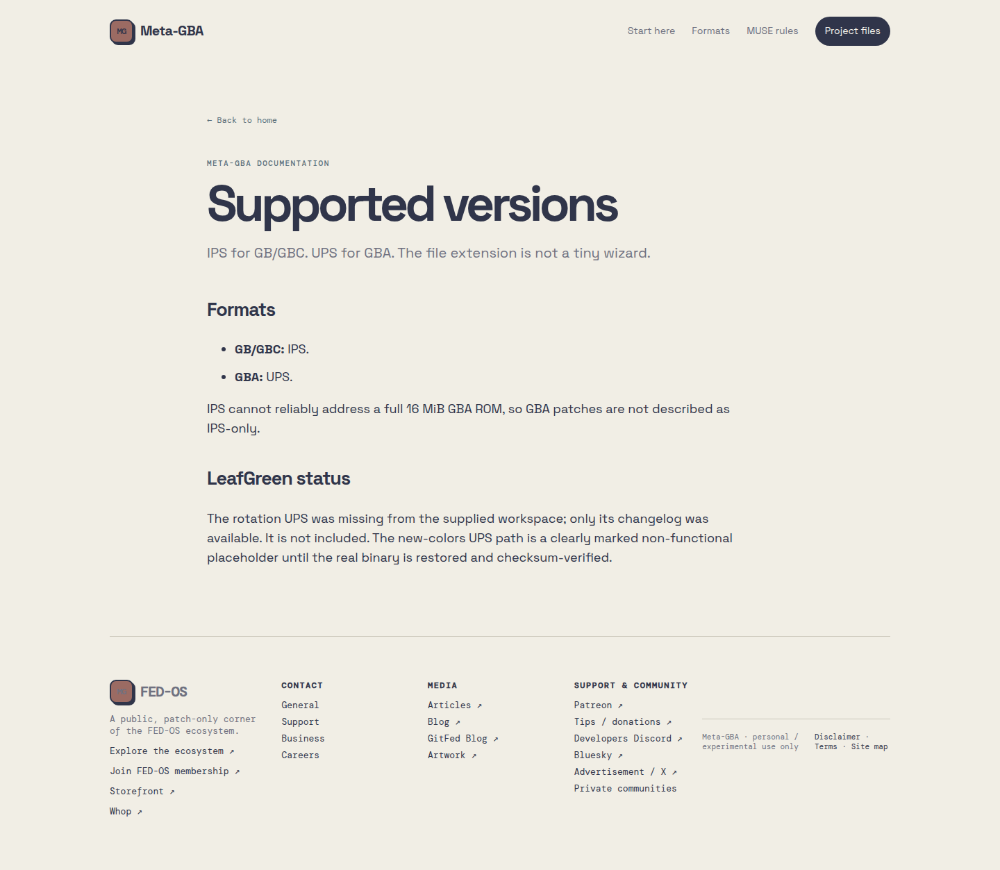

# Meta-GBA


A static, patch-only landing site and documentation hub for careful personal experimentation with legally owned GB, GBC, and GBA ROM dumps.


## Why this exists

ROM-patching advice is often buried in forum threads, mixed across incompatible versions, or presented as if a similarly named file is good enough. That is how people overwrite clean backups, apply the wrong patch format, or discover a hardware problem before they have tested in an emulator.

Meta-GBA turns the safest parts of that workflow into a small, readable static site: identify the exact version, back up first, use the right format, test in an emulator, and keep the change reviewable. It is intentionally a feature edition rather than a paid tier, and it stays personal, experimental, non-commercial, and patch-only.

The project is also explicit about scope. MUSE limits work to **1 game / 24 hours**, refuses bulk edits, prefers editing over adding, and suggests an original game with legal assets when a request would cross the line. “Not allowed” means not discussed.

## See it work

The fastest working demo is the local static site. There is currently **no verified public live demo** in this repository, and no GitHub Actions workflow or Wrangler deployment file is present. The files are nevertheless ready for static hosting because the entry point is plain `index.html`, with Cloudflare `_headers` and `_redirects` already included.

- [Open the landing page](index.html)
- [Start with the safe workflow](docs/start-here.html)
- [Check IPS vs. UPS and the LeafGreen status](docs/supported-versions.html)
- [Browse the project files](download.html)



The GIF above is a real scroll-through capture of the local HTML site, not a product mockup. The static pages show the project’s actual workflow and current artifact status.

## Screenshots







## Quick start

This project has no package manager, build step, or runtime dependency. Use any static file server.

```bash
# clone or download the repository, then enter it
cd Meta-GBA

# run the site locally
python3 -m http.server 4173
```

Open <http://127.0.0.1:4173/index.html> in a browser. The quickest useful click path is:

1. **Start safely**
2. **Read the rules**
3. **Check the supported version and patch format**
4. **Run the safety checklist before applying anything**

Run the repository’s real static-site check in a second terminal:

```bash
python3 scripts/check_site.py
```

It checks required assets and local HTML references. There is no automated emulator test suite in this repository.

## What is in the tree

- `index.html` — the actual site entry point.
- `docs/` — HTML pages for the safe workflow, rules, formats, MUSE, safety, and troubleshooting.
- `assets/` — favicon, site stylesheet, promotional art, and real demo captures.
- `examples/leafgreen-color-patches/` — changelogs plus a clearly marked **non-functional placeholder** where the new-colors UPS binary was unavailable.
- `support.html` — optional support links and hosted-provider widgets.
- `advanced.html` and `worker/` — an honest explanation and sketch for server-side Cloudflare gating. Static HTML alone cannot securely verify payment.
- `_headers` and `_redirects` — Cloudflare Pages-compatible headers and friendly routes.
- `meta-gba.zip` — downloadable archive copy; it is excluded when the outer archive is rebuilt so it does not contain itself.

## Patch format and artifact status

Use **IPS for GB/GBC** and **UPS for GBA**. IPS cannot reliably address a full 16 MiB GBA ROM, so this project does not describe GBA patches as IPS-only.

The LeafGreen rotation UPS file was not available in the supplied workspace; only its changelog was present. It is not claimed to be included. The new-colors UPS path is marked as a placeholder until the legitimate binary is restored and checksum-verified. A changelog is documentation, not an executable patch.

## Deployment

### GitHub Pages

Publish the repository root as a static site. No build command is required. `index.html` is the entry point. GitHub Pages does not execute the payment or Cloudflare Worker logic; those support and gating pieces remain hosted-provider/Worker concerns.

### Cloudflare Pages

Connect the repository with no framework preset and no build command. Use the repository root as the output directory. `_headers` and `_redirects` are included for Pages-compatible routing and security headers.

The Worker files are a deployment contract and review starting point, not a finished payment-verification system. Provider webhooks, secrets, entitlement storage, and signed access tokens must be implemented and tested server-side before any real gated content is exposed.

## Guardrails

Meta-GBA is for personal or experimental use only, with no commercial use. It distributes documentation and patch-oriented artifacts, not ROMs, BIOS files, or copyrighted game assets. Back up first and test in an emulator. Careless or unauthorized work can risk losing an account, being sued, or going to jail depending on the action and jurisdiction.

Read [MUSE.md](MUSE.md), [RULES.md](RULES.md), and [DISCLAIMER.md](DISCLAIMER.md) before changing the tree.

## Contributing

Keep changes small, reviewable, and reversible. Prefer editing an existing file over adding a parallel version. Include the source version, target version, format, checksum expectations, legal asset provenance, and emulator test status when contributing a patch artifact.

## License and terms

See [LICENSE.md](LICENSE.md). Referenced games, ROMs, trademarks, and third-party assets remain owned by their respective rights holders.
